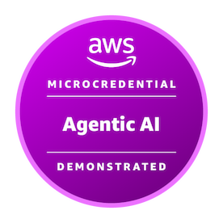
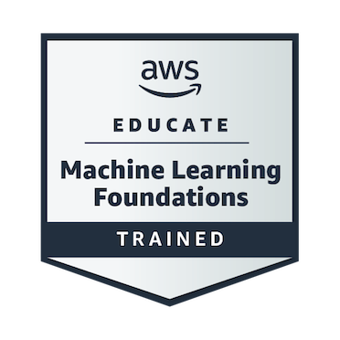

# Leen Pimentel

**AI / Agent Engineering | Agentic Systems | Python | AWS**

I'm an early-career AI / Agent Engineering professional transitioning from a background in Design, digital products, and UI/UX into software and AI engineering.

My design experience shaped how I approach technical systems: understanding context, defining responsibilities, identifying constraints, and making complex interactions understandable.

Today, I apply that perspective to building agentic systems with Python and AWS, focusing on how models, tools, external state, memory, and deterministic components work together.

I'm particularly interested in **system architecture, orchestration, context boundaries, evidence-based reasoning, and the distinction between what an AI model can infer and what a system can reliably establish.**

## Featured Engineering Projects

### [Elementary — Context-Aware Diagnostic Agent](https://github.com/giskardleen/elementary-context-aware-diagnostic-agent)

A context-aware diagnostic agent designed to investigate technical issues across fragmented sources of information.

The system combines product documentation, represented environment state, deterministic validation, historical context, and external technical information.

**Engineering focus:** Evidence-grounded diagnosis, authority boundaries, deterministic validation, explicit authorization, and controlled side effects.

The implementation separates model reasoning from factual authority and includes eight validated capability scenarios (T1–T8), architecture documentation, and recorded execution evidence.

### [Multi-Agent Customer Support System](https://github.com/giskardleen/multi-agent-customer-support-system)

A multi-agent customer support architecture built with Strands Agents and Amazon Bedrock AgentCore.

The system coordinates an orchestrator and specialized agents for inventory, policy retrieval, refund processing, and customer communication. Three specialized retrieval agents support parallel knowledge retrieval.

**Engineering focus:** Multi-agent orchestration, delegation strategies, shared workflow state, parallel RAG, concurrency control, guardrails, and observability.

The implementation uses DynamoDB with optimistic locking, distinct model responsibilities, AWS X-Ray and CloudWatch. The repository also documents guardrail evaluations, including failures, inconclusive results, and targeted retesting.

### [AI Customer Support Agent](https://github.com/giskardleen/AI-Customer-Support-Agent)

An agentic customer support application integrating multiple capabilities through Amazon Bedrock AgentCore and AWS managed services.

The agent coordinates operational tools, knowledge retrieval, persistent customer context, deterministic calculations, and external information access.

**Engineering focus:** Tool orchestration, MCP integration, RAG, memory, deterministic computation, and runtime observability.

The repository documents six end-to-end validation scenarios and the separation between model coordination and systems responsible for operational state.

## Engineering Focus

- **Agent Architecture & Orchestration:** Agent responsibilities, delegation, coordination patterns, and deterministic workflows.
- **Context, State & Memory:** Session context, persistent memory, shared workflow state, and ownership boundaries.
- **Tool & System Integration:** MCP, APIs, AWS Lambda, AgentCore Gateway, and external capabilities.
- **Knowledge & Evidence:** Retrieval-Augmented Generation, knowledge bases, source authority, and evidence-grounded reasoning.
- **Reliability & Control:** Guardrails, authorization boundaries, observability, testing, and explicit handling of uncertainty.

**Primary technologies:** Python, AWS, Amazon Bedrock, Amazon Bedrock AgentCore, Strands Agents, MCP, DynamoDB, Lambda, API Gateway, S3, CloudWatch, and X-Ray.

## Credentials & Learning

### Verified Credentials

**AWS Agentic AI Demonstrated**  
Amazon Web Services Training and Certification  
Issued October 31, 2026 · Expires October 31, 2027  
Practical assessment: 6/6 challenges passed.  
[Verify credential](https://www.credly.com/badges/b339ecfa-deb6-4540-98dd-8f422ec54769/public_url)

**Build with Retrieval-Augmented Generation**  
OpenAI Academy  
Issued October 24, 2026 · Expires April 24, 2027  
[Verify credential](https://oaiacademy.credential.net/304a8449-283f-44ed-b39a-0e4f8aeb1a96)

### Anthropic Courses — Certificates of Completion

- **[AI Capabilities and Limitations](https://verify.skilljar.com/c/5n98w4i66kw4)** — [View certificate](https://verify.skilljar.com/c/5n98w4i66kw4)
- **[AI Fluency: Framework & Foundations](https://verify.skilljar.com/c/fzrmfgyz45r4)** — [View certificate](https://verify.skilljar.com/c/fzrmfgyz45r4)
- **[Introduction to Claude Cowork](https://verify.skilljar.com/c/kw5kxr8bdnnz)** — [View certificate](https://verify.skilljar.com/c/kw5kxr8bdnnz)
- **[Introduction to Model Context Protocol](https://verify.skilljar.com/c/c6jdmbk2urac)** — [View certificate](https://verify.skilljar.com/c/c6jdmbk2urac)

### Additional Training

**AWS Educate — Machine Learning Foundations**  
Amazon Web Services · Trained

### Education

**Future AWS Agent Engineer Nanodegree** — AWS / Udacity  
Completed October 2026.

## Connect

- [LinkedIn](https://www.linkedin.com/in/leenpimentel/)
- [GitHub](https://github.com/giskardleen)
- [Credly](https://www.credly.com/users/lin-pimentel)
